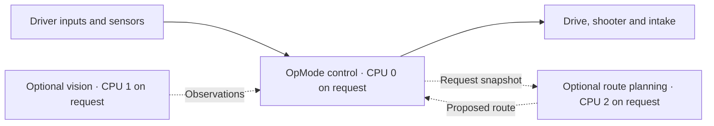

# From Task Scheduling to Predictable Robot Control

**F.R.O.G. · Frog Robots of Germany · FTC Team #10183**

## Portfolio copy

### One thread owns robot control

We first built a task scheduler to run recurring jobs and timed actions in the background. During autonomous development, we found that the scheduler and the main control loop could both command the shooter motor. A slow hardware read on the scheduler could also delay the signal that ended a shot. We moved shooter regulation, intake timing and action deadlines into the same control loop. Each cycle now reads the relevant inputs, updates the robot state and applies the resulting commands in order.

### Less work in each cycle

We share eligible encoder readings through the hub’s bulk cache and reuse the shooter’s velocity samples for regulation and readiness checks. We build diagnostic telemetry at most every 100 ms and stagger the two intake distance reads to spread their communication cost across cycles. On supported odometry firmware, our compact read carries position, velocity, device status and a checksum in 29 bytes. The standard read carries 40 bytes.

### Testing thread placement

Our optional camera and route-planning workers let us move these workloads outside the control loop. We can request CPU 0 for robot control, CPU 1 for vision and CPU 2 for planning. The software checks the effective setting and reports any failure to restore a thread’s original CPU mask on exit. We designed the benchmark to compare slow cycles and completed work under equivalent loads. Desktop tests cover the control logic. A timing comparison on the complete robot is still pending.

## Technischer Hintergrund und Quellen

Stand **15. November 2026**. Die letzten Performance-Änderungen liegen im lokalen Hauptcheckout auf Basis von `330769a`. Die Angabe zur Core-Konfiguration unterscheidet deshalb zwischen Commit und lokalem Arbeitsstand.

### 1. Der frühere TaskManager

Mit dem TaskManager sammelten wir zeitgesteuerte Java-Aufgaben in einer zentralen Warteschlange. Ein wiederverwendeter `ScheduledThreadPoolExecutor` mit genau einem Thread führte sie nacheinander aus. Der Daemon-Thread `TaskManager-worker` war im Debugger am Namen erkennbar und lief mit niedriger Java-Threadpriorität. Er hatte keine eigene CPU-Affinitätsanfrage. Als Daemon hielt er den Prozess beim Beenden nicht allein am Leben. [Letzte Implementierung im Git-Verlauf][taskmanager] · [Java-Executor-Referenz][executor]

| Funktion | Verhalten |
| --- | --- |
| `run_once()` und `run_once_delayed()` | Einmalig auf dem Worker ausführen, sobald er verfügbar ist und ein eventueller Start-Delay abgelaufen ist. |
| `schedule()` und `schedule_delayed()` | Wiederholen, wahlweise mit anfänglicher Verzögerung. Bei *fixed delay* beginnt die Pause nach dem Ende des letzten Aufrufs. Ein Job mit 20 ms Delay und 5 ms Laufzeit startet zum Beispiel frühestens nach rund 25 ms erneut. Die Zahlen illustrieren das Verfahren. |
| Namen und Registrierung | Erneutes Einplanen unter demselben Namen bricht den bisherigen Eintrag ab und ersetzt ihn. Die Bereinigung entfernt per Objektidentität nur den eigenen Eintrag. Dadurch kann ein spät endender Job seinen Nachfolger nicht aus der Registrierung löschen. Einmalige Jobs und fehlgeschlagene Einreichungen werden bereinigt. |
| Zeitwerte und Fehler | `Units.Time` erlaubt z. B. Millisekunden oder Sekunden am Aufrufort. Verzögerungen müssen endlich und mindestens 0 ms sein, Wiederholungsabstände mindestens 1 ms. Der Executor erhält auf ganze Millisekunden gerundete Werte. Normale Ausnahmen werden protokolliert. Ein schwerer Java-`Error` beendet die Wiederholung. |
| `cancel()`, `cancel_and_await()`, `stop_all()` | Ein Abbruch verhindert weitere Aufrufe und fordert den laufenden Job per Interrupt zum Beenden auf. `cancel_and_await()` wartet begrenzt auf das tatsächliche Ende des beobachteten Tasks. Der globale Stopp wartet bis zu 500 ms, außer wenn der Worker sich selbst stoppt. Abgebrochene Einträge werden aus der Executor-Warteschlange entfernt. |
| Diagnose | Registrierte Namen, Anzahl und Namensabfrage zeigen auch Tasks, die gerade auf ihren Einsatz warten. Der Executor wurde bei Bedarf angelegt und konnte nach dem Stopp neu starten. |

Der einzelne Worker machte die Reihenfolge seiner eigenen Tasks nachvollziehbar. Er konnte die Wartezeit hinter einem langen Job nur auf weitere Tasks übertragen. Ein aktiver Task musste auf Unterbrechung reagieren, damit ein Abbruch zeitnah wirksam wurde. Die Registry allein koordinierte auch keine Zugriffe aus dem OpMode-Thread. [Historische Erklärung](taskManager-explanation.md)

#### Warum er aus dem Wettbewerbscode verschwand

| Datum | Änderung |
| --- | --- |
| 5. Oktober 2026 | In `572c105` plante Autonomous eine Flywheel-Regelung mit 20 ms Wiederholungsabstand und getrennte verzögerte Signale für Intake und Schussende ein. Der Worker konnte die Motorleistung schreiben, während der OpMode beim Schießen denselben Motor ansteuerte. Die Zeit-Signale teilten sich die Warteschlange mit Hub-Lese- und Schreibzugriffen. |
| 7. Oktober 2026 | `43e4e93` verlagerte den Shooter-Update und die betreffenden Zeitgrenzen auf den OpMode-Thread. Seitdem hat der Regelkreis einen Besitzer für Sensorabfrage, Entscheidung und Aktuatorbefehle. Fristen werden mit der monotonen Uhr `System.nanoTime()` während der Schleife geprüft. Eine blockierende SDK-Abfrage kann die nächste Prüfung weiterhin verzögern. |
| 17. Oktober 2026 | Das Review hielt fest, dass keine Aufgaben mehr eingeplant wurden, die periodische Registry leer war und es keine unabhängigen Nutzer von `LogManager` gab. Die Entfernung der verbliebenen Infrastruktur wurde als Wartungsvereinfachung freigegeben. |
| 23. Oktober 2026 | `cd6b69b` löschte `TaskManager`, `PeriodicRegistry` und `LogManager` sowie die restlichen Lebenszyklusaufrufe. Die drei Klassen umfassten zusammen 511 Zeilen. |

Der Architekturwechsel beseitigte konkurrierende Flywheel-Befehle und die zusätzliche Warteschlange auf dem Weg zum Schussende. Die spätere Löschung vereinfachte den Code, nachdem der Worker in den Wettbewerbsläufen bereits keine Aufträge mehr hatte. [Frühe Auto-Implementierung][early-auto] · [Umbau][ownership-commit] · [Readiness-Audit](Competition-Readiness-Audit-2026-10-07.md#recent-commit-findings-and-current-status) · [Cleanup-Review](Overengineering-Review-2026-10-17.md) · [Löschcommit][delete-commit]

#### Warum wir den TaskManager durch den OpMode-Loop ersetzt haben

**Beim alten Schussablauf** las der TaskManager-Worker die Flywheel-Drehzahl am Hub und setzte die Motorleistung für seine Drehzahlregelung. Beim Schuss konnte der OpMode-Thread den gleichen Motor mit einer eigenen Leistungsstrategie ansteuern. Beide Befehle konnten einzeln korrekt ausgeführt werden und sich trotzdem gegenseitig überschreiben. Welche Leistung am Ende anlag, hing dann von der Reihenfolge ab, in der die Befehle den Motor erreichten. Eine Sperre im Motor-Wrapper kann die einzelnen Schreibzugriffe nacheinander ausführen lassen. Die Entscheidung, welche Regelung in diesem Moment gelten soll, braucht trotzdem einen eindeutigen Besitzer. [Frühe Auto-Implementierung][early-auto] · [Readiness-Bericht zum Flywheel](Competition-Readiness-Report.md#f03--autonomous-flywheel-control-has-two-owners)

**Auch das Schussende hing vom Worker ab.** Nach Ablauf der geplanten Dauer sollte ein Callback ein `AtomicBoolean` setzen. Dieses Flag machte die Änderung für den OpMode-Thread sichtbar. Lief beim Fälligwerden gerade der Flywheel-Job und wartete auf eine Antwort vom Hub, blieb der Callback in der Warteschlange. Der OpMode konnte in der Zwischenzeit weiterlaufen, sah das Flag aber erst, nachdem der Worker den Callback ausgeführt hatte. Der verzögerte Intake-Start nutzte denselben Übergabemechanismus. [Frühe Auto-Implementierung][early-auto] · [Readiness-Bericht zu den Zeitgrenzen](Competition-Readiness-Report.md#f04--the-same-worker-controls-flywheel-hardware-and-shot-deadlines)

**Heute** beschreibt die Auto-Aktion, wann der Shooter vorbereiten, schießen oder aufhören soll. Der OpMode-Thread prüft die verstrichene Zeit selbst, aktualisiert den Follower und ruft den Shooter-Update auf. Dort fließen Drehzahl, Bereitschaft und der angeforderte Schuss in die Entscheidung ein, welche Leistung Flywheel und Transfer erhalten. Nach Ablauf des Schussfensters beendet die Aktion die Zufuhr in ihrem `finally`-Block. Bei STOP oder einem Abbruch werden die Aufräumschritte ebenfalls versucht. Eine fehlerhafte Abschaltoperation lässt die übrigen Aufräumschritte weiterlaufen und bleibt als Fehler nachvollziehbar. [Auto-Schussablauf][auto] · [Shooter-Regelung][shooter] · [OpModeCleanup](TeamCode/src/main/java/org/firstinspires/ftc/teamcode/core/control/OpModeCleanup.java)

| Abwägung | Früherer TaskManager | Heutiger OpMode-Loop |
| --- | --- | --- |
| **Aufgaben organisieren** | Ein zentraler Aufruf konnte einen Job verzögert starten, wiederholen, ersetzen oder abbrechen. Für mehrere unabhängige kurze Aufträge ist das kompakt. | Verzögerungen brauchen einen Zustand oder eine Frist in der jeweiligen Aktion. Beim Lesen der Aktion sieht man dafür direkt, wann sie beginnt, worauf sie wartet und wie sie endet. |
| **Reihenfolge und Daten** | Die Jobs innerhalb des Workers liefen nacheinander. Zwischen Worker und OpMode mussten Zustände, Signale und Zugriffe auf gemeinsam genutzte Hardware eigens abgestimmt werden. | Der Regelkreis gibt Lesen, Entscheiden und Schreiben eine feste Reihenfolge. Werte aus einem Durchlauf können für Regelung und Bereitschaftsprüfung gemeinsam genutzt werden. |
| **Reaktion auf Last** | Ein unabhängiger kurzer Job konnte parallel zum OpMode laufen. Ein langer Job auf dem einzigen Worker verzögerte die dort wartenden Aufgaben. | Die Zeitprüfung liegt direkt in der Aktion und umgeht die Worker-Warteschlange. Ein langsamer SDK-Aufruf oder viel Rechenarbeit im OpMode verzögert dafür auch die anderen Schritte dieses Loops. |
| **Zeitgenauigkeit** | Ein Delay machte einen Job nach Ablauf der Zeit ausführbar. Der tatsächliche Start hing von Worker-Auslastung und Scheduler ab. | Die Frist wird bei der nächsten Prüfung in der laufenden Schleife erkannt. Ein langer Zyklus kann den Schaltzeitpunkt verschieben. Auch dieses System bietet daher nur eine softwareseitige Zeitgrenze. |
| **Fehler und Abschaltung** | Normale Task-Ausnahmen konnten protokolliert werden, während ein periodischer Job weiter eingeplant blieb. Der Aufrufer brauchte einen eigenen Rückkanal, um daraus einen Abbruch abzuleiten. Ein laufender Job musste außerdem auf den Interrupt reagieren. | Zusammengehörige Hardwarebefehle und Aufräumschritte folgen demselben Aktionsablauf. Ein blockierender SDK-Aufruf kann die Reaktion auf STOP weiterhin bis zu seiner Rückkehr verzögern. |

Die damaligen Scheduler-Aufträge betrafen denselben Schussablauf und dieselbe Hardware wie der OpMode. Darum war die gemeinsame Reihenfolge für uns wichtiger als der Komfort eines allgemeinen Zeitplaners. Nach dem Umbau hatte der Scheduler keine Aufträge mehr. Sein Ausbau spart vor allem Code und einen zusätzlichen Lebenszyklus, den das Team bei Änderungen hätte mitdenken müssen. Für unabhängigere Arbeit wie Kameraverarbeitung oder Routensuche haben wir eigene optionale Worker. Sie liefern Daten und Vorschläge zurück. Die Entscheidung über Motorbefehle bleibt beim OpMode. [Cleanup-Review](Overengineering-Review-2026-10-17.md) · [Worker-Integration][workers]

### 2. Performance im Regelkreis

TeleOp und Autonomous aktualisieren den Pedro-Follower samt Lokalisierung und die Mechanismen im OpMode-Thread. Die Auto-Routen bauen ihre statischen Pfade in INIT auf. Während der Fahrt läuft vor allem die Ausführung der vorbereiteten Aktionen. [TeleOp-Basis][teleop] · [Auto-Basis][auto]

| Maßnahme | Umsetzung und Wirkung |
| --- | --- |
| **REV-Hub Bulk Caching** | INIT nutzt `AUTO`. Nach START nutzen die Basisklassen `MANUAL` und leeren jeden Hub-Cache vor dem nächsten Satz Sensorabfragen. So können geeignete Werte wie Encoderposition und -geschwindigkeit pro Hub denselben Datenblock nutzen. Intake-Abstandssensoren und Pinpoint verwenden eigene I²C-Abfragen. |
| **Encoderwerte wiederverwenden** | Der Shooter liest beide Flywheel-Encoder je Update einmal. Zwei gültige Werte werden gemittelt, bei einem Ausfall wird der andere gültige Wert verwendet. Regelung, Bereitschaft und Anzeige verwenden dieselben Samples. Ein Sample hält die Gültigkeit getrennt vom letzten endlichen Messwert. |
| **Aktuatorbefehle filtern** | Die Leistungsschwelle beträgt `0,002` für die Shooter-Motoren und `0,01` für Intake und Transfer auf der normierten Leistungsskala. Der Vergleich erfolgt mit dem zuletzt weitergegebenen Befehl, sodass kleine Änderungen sich bis zur Schwelle addieren können. Der Übergang auf exakt null wird weitergegeben. Der Servo-Code filtert kleine Positionsänderungen. Beim Hood kommt die Zeit seit dem letzten akzeptierten Positionsbefehl als Bereitschaftskriterium hinzu. Die FTC-Treiber haben zusätzlich eigene Caches für wiederholte identische Werte. |
| **Berechnungen wiederverwenden** | Der Roboter validiert eine neue Pose an der Schnittstelle zur Steuerung. Die Hive-Distanz wird bei unveränderten X/Y-Koordinaten, unveränderter Allianz und gleicher Gültigkeit wiederverwendet. Zielberechnung und Regelung behalten ihre Validitätsprüfungen. |
| **Diagnose alle 100 ms** | Die Teamschleifen bauen periodische Laufzeit- und Debug-Telemetrie jetzt höchstens alle 100 ms auf und rufen erst dann `update()` dafür auf. Vorher begrenzte das FTC-Intervall die Sendefrequenz, während die Java-Daten pro Durchlauf aufgebaut wurden. Gamepad-Ereignisse und INIT-Meldungen haben eigene Aufrufstellen. Die eigentliche Steuerung arbeitet in jedem Zyklus. |
| **Ein Scheduler-Yield in Auto** | Das verwendete FTC SDK 12.0.0 ruft in `opModeIsActive()` bei aktivem OpMode bereits `idle()` auf. Dieses gibt mit `Thread.yield()` anderen lauffähigen Threads eine Gelegenheit. Zwei Auto-Schleifen verzichteten auf den zusätzlichen Aufruf am Zyklusende. Der SDK-Aufruf am Schleifenanfang und der INIT-Ablauf sind weiterhin Teil der Steuerung. |
| **Intake-I²C gestaffelt** | Die obere und untere Distanzmessung wechseln sich ab. Zwischen Abschluss eines Reads und Beginn des nächsten liegen mindestens 150 ms. Damit liegt der nominelle Abstand pro Sensor bei 300 ms, zuzüglich I²C- und Schleifenlaufzeit. Pro fälligem Termin liest der Code einen Sensor. Ein gültiges Paar braucht zwei endliche Werte mit höchstens 350 ms Alter je Wert und höchstens 200 ms Abstand zwischen den Erfassungen. Nach aktivem Transfer oder STOP sind zwei neue Messungen erforderlich. |
| **Kompaktes Pinpoint-Lesefenster** | Der GoBILDA-Treiber nutzt bereits 400 kHz I²C. Ab Firmware 3 fordert der Code sieben 32-Bit-Register an, nämlich Gerätestatus, X/Y/Heading und die drei Geschwindigkeiten. Das ergibt 28 Byte Nutzdaten plus ein CRC-Byte zur Fehlererkennung, insgesamt 29 Byte gegenüber 40 Byte in der Standardantwort. Die Einstellung wird beim Start geprüft. Bei nicht verifizierter Einrichtung versucht der Code das Standardfenster wiederherzustellen und zu prüfen. Firmware 1 und 2 sowie die Tuning-OpModes verwenden das Standardfenster. Ein fehlerhafter CRC-Read im Kompaktbetrieb wird einmal wiederholt, danach bricht ein anhaltender Fehler den OpMode ab. `PREFER_COMPACT_PINPOINT_BULK_READS` schaltet beim Vergleich zwischen den Fenstern um. |

Die beiden Belegungsschwellen des Intake liegen noch bei **0 mm**. Bei üblichen nichtnegativen Distanzwerten führt die Schwelle zu keiner Vollmeldung. Die Sensoren müssen mit leerem und gefülltem Intake kalibriert werden. Die Staffelung senkt die Zahl der Abfragen, die dicht aufeinander folgen, und nimmt dafür unterschiedliche Erfassungszeitpunkte in Kauf. [Intake-Implementierung][intake] · [Kalibrierhinweise](Robot-Bringup-Tuning-and-Constants.md)

Für `SoloWithSteal` sind fünf Transferfenster à **1,25 s** vorgesehen. Das Flywheel dreht im Betrieb bereits im FLOAT-Zustand mit einem Sollwert von 3000 Umdrehungen pro Minute (RPM). Für eine später kalibrierte entfernungsabhängige Regelung gibt es eine Vorbereitung, die während der Anfahrt das RPM-/Hood-Ziel aus dem geplanten Pfadende berechnet. Der Aufruf ist auskommentiert. Beim tatsächlichen Schuss prüft die Steuerung die Bereitschaft am Schusspunkt und startet dann den Transfer. [Auto-Schussablauf][auto] · [SoloWithSteal][solo] · [Shooter][shooter]

[Loop-Zeitmessung][looptiming] · [Motor-Cache][motor] · [Servo-Cache][servo] · [FTC-Telemetrie][ftctelemetry] · [Pinpoint-Implementierung][pinpoint] · [Herstellerdokumentation zum Lesefenster][gobilda]

### 3. Thread-to-Core-Zuordnung

| Thread | Arbeit | CPU-Anfrage und Status |
| --- | --- | --- |
| **OpMode** | Gamepads, Pedro, Lesen der Mechanik-Sensoren, Motor- und Servo-Befehle, Fristen und Entscheidungen. | `CONTROL_CORE = -1` im eingecheckten Stand behält die geerbte Auswahl zulässiger CPUs. Der lokale Stand fordert mit `0` CPU 0 an. |
| **Limelight-Worker** | Kameraabfragen, aktuelle Ergebnisse verarbeiten, Ziele ins Feldkoordinatensystem projizieren und veröffentlichen. | `preferredCore = 1`. Der Wettbewerbspfad hat die optionale Unterstützung und Kameraabfrage deaktiviert. |
| **Butine-Worker** | Aus Eingabesnapshots einen Routenplan berechnen und das Ergebnis veröffentlichen. | `preferredCore = 2`. Der Wettbewerbspfad startet den optionalen Worker derzeit nicht. |
| **Diagnose-Sampler** | CPU- und Threadwerte auslesen. | Separater schlafender Thread im stationären Test. Liest mit 2 Hz und behält seine geerbte Maske. |

Butine wartet ohne Auftrag und hält höchstens einen ausstehenden Planungsauftrag. Ein neuer Auftrag ersetzt den ausstehenden und entwertet alte Ergebnisse. Ein bereits laufender Suchlauf kann noch enden, bevor das Ergebnis verworfen und der nächste Auftrag bearbeitet wird. Die Steuerung entscheidet anhand von Anfrage, Pose, Zielen und verbleibender Zeit, ob ein Ergebnis zur Ausführung passt. Der Limelight-Worker zielt auf einen 10-ms-Zyklus, prüft den Kamerazustand etwa alle 250 ms und wartet nach kurzen Zyklen bis zum nächsten Termin. Pipeline-Anfragen werden zusammengefasst und es kann höchstens ein weiterer Snapshot-Auftrag warten. [Vision-Worker][vision] · [Planungs-Worker][planner] · [Worker-Integration][workers] · [Konfiguration][config]

`ThreadAffinity` ermittelt im betroffenen Thread über `android.os.Process.myTid()` die **TID** (native Linux-Thread-ID). Es liest die ursprüngliche Maske, setzt die gewünschte Maske über Androids Toybox-`taskset` und prüft die effektive Maske per Read-back. In der Bitmaske steht jedes Bit für eine zulässige CPU. CPU 0, 1 und 2 entsprechen einzeln `0x1`, `0x2` und `0x4`. Eine Maske `0x3` lässt einen Thread auf CPU 0 **oder** CPU 1 laufen. Ein Thread läuft immer nur auf einer CPU gleichzeitig. Andere Android- und SDK-Threads dürfen dieselben CPUs weiterhin nutzen. [ThreadAffinity][affinity] · [Android-TID][androidtid] · [Linux-Affinität][linuxaffinity]

Die OpModes starten optionale Worker vor der Zuordnung des OpMode-Threads, da neu gestartete Threads die CPU-Maske ihres Erzeugers erben können. Der OpMode setzt seine eigene Maske während INIT. Worker setzen ihre Maske beim eigenen Start. Beim Beenden versucht jeder Besitzer, die ursprüngliche Maske seines Threads wiederherzustellen. Die Anwendung meldet fehlgeschlagene Zuordnungs- oder Wiederherstellungsversuche. Eine enge Maske kann CPU-Migrationen reduzieren, bei einem ausgelasteten Kern aber auch Wartezeiten verlängern. [ControlThreadAffinity][controlaffinity] · [Affinitätsintegration](Competition-Control-Thread-Affinity-Plan-2026-10-17.md)

### 4. Benchmark und bisherige Ergebnisse

`LoopTiming` zeigt **Work time** für die Arbeit bis zur Telemetrie und **Cycle time** für die Zeit zwischen zwei aufeinanderfolgenden Zyklusstarts. Cycle time enthält somit auch Diagnose, Wartezeit und Scheduler-Effekte. Aus der Zyklusdauer in Millisekunden lässt sich die entsprechende Rate als `1000 / cycleMs` berechnen. Für die Regelung interessieren vor allem die langsamen Ausreißer. p95 und p99 sind die Zeiten, innerhalb derer 95 bzw. 99 Prozent der aufgezeichneten Zyklen lagen. Das Maximum zeigt den längsten aufgezeichneten Zyklus. [LoopTiming][looptiming]

- **Hardware- und Softwarevergleiche.** Die getrennte OpMode **Performance comparison** kann Bulk-Cache-Modi, Motor-/Servo-Befehlsfilter, Wiederverwendung von Encoderdaten, Distanzabfrage und Staffelung, Telemetrietakt, Zielberechnungen, Wiederverwendung von Schussresultaten und das Filtern wiederholter Geschwindigkeitsbefehle isoliert vergleichen. Sie speichert Rohwerte und Zusammenfassungen unter `FIRST/performance-comparison` als CSV mit Median, p95, p99, Maximum und Zyklen über 10 bzw. 20 ms. Statistiken und Dateiexport laufen nach dem Messblock. Der Shadow-Modus prüft die Aufruflogik anhand simulierter Ausgaben. Für reale Buszeiten sind echte Geräte und gegebenenfalls die kontrollierte Live-Ausgabe erforderlich. [PerformanceComparison][comparison] · [Vergleichsaufbau](Performance-Cleanup-and-Benchmark-Plan.md)
- **CPU-Zuordnung.** Der stationäre **Limelight CPU thread test** ist im Quellcode mit `@Disabled` markiert. Er vergleicht die Originalmasken mit den erlaubten OpMode-CPU-Mengen `{0}`, `{0,1}` und `{0,1,2}`. In diesen drei Testmodi wird für Vision CPU 1 und für die Planung CPU 2 angefragt. Der Test kann einmal pro Sekunde einen synthetischen Solve anbieten und zählt auch übersprungene Angebote. Er zeigt CPU-Masken, p95/p99, Maximum und Zyklen über 5 bzw. 6 ms. Die dort angezeigten **4–6 ms** und das Zielbeispiel **5 ms = 200 Hz** beschreiben Annahmen und Vergleichsschwellen. Gemessene Zykluszeiten mit allen Robotersubsystemen stehen aus. [CpuThreadTest][cputest]
- **A/B am Roboter.** Für die Zuordnung `-1` gegen `0` denselben Hub, dieselbe Routine sowie dieselbe Telemetrie und Sensorlast verwenden. Die effektiven Masken, Temperatur und Takt protokollieren. Warm-up aus der Auswertung herauslassen und Läufe wiederholen. Bei aktiven Workern zusätzlich Bildalter, eindeutige verarbeitete Frames, Overruns sowie abgeschlossene, übersprungene und verworfene Planungsaufträge vergleichen. Für Telemetrie, Intake-Reads und das Pinpoint-Fenster jeweils nur einen Parameter pro Versuch ändern und die Dauer der betroffenen Abschnitte erfassen.
- **Build und Desktop-Tests.** `:TeamCode:assembleDebug` erzeugte das Debug-APK. Die kompatiblen Desktop-Prüfungen für den Regelkreis, Intake, Shooter, CPU-Masken und den Pinpoint-Treiber liefen mit simulierten Geräten. Die Pinpoint-Simulation prüfte 31 Fälle für Registerreihenfolge, CRC, Wiederholung und Rückfall. Der optionale Butine-Integrationstest bestand bei isolierter Wiederholung mit 119 Checks. Vier ältere Benchmark-Testprogramme setzen Klassen aus einer anderen Benchmark-Version voraus und wurden für diesen Lauf ausgefiltert. Die physische Sensorlatenz, Affinitätswirkung und relative Zykluszeit wurden dabei nicht ermittelt. [Desktop-Prüfungen](tests/README.md)

#### Separates Control-Hub-Experiment

Am 9. Oktober 2026 verglichen wir zwei Hubs mit derselben SHA-1-Aufgabe. Pro Hub gab es einen Warm-up und fünf Messläufe über 64 MiB Nulldaten. Beide liefen mit dem Governor `performance` bei einer eingestellten Frequenz von 1,512 GHz. Die Mediane lagen bei **4,10 s** für Hub A und **4,00 s** für Hub B. Daraus ergeben sich **15,6098** bzw. **16,0000 MiB/s** und rund **2,5 %** Durchsatzunterschied in dieser Testserie. Die Einzelwerte überlappten. Der Test dokumentiert die konkrete SHA-1-Arbeit einschließlich Datenbewegung. Für OpMode-Zykluszeit, CPU-Pinning und einen Governor-Vorher-/Nachher-Vergleich gibt es aus diesem Versuch keine Messreihe. [Control-Hub-Messprotokoll](Control-Hub-Benchmark-2026-10-09.md)

CPU-Affinität steuert die zulässigen CPUs eines Threads. Der Governor `performance` fordert innerhalb der bestehenden Frequenzgrenzen den höchsten erlaubten Takt an. Das Batch-Skript im Schwesterprojekt ist ein separates Gerätetuning mit optionalem Eingriff in den Thermal-Service. [Skriptanalyse](Control-Hub-Performance-Mode.md) · [Linux-CPUFreq][cpufreq]

[taskmanager]: https://github.com/F-R-O-G-Frog-Robots-of-Germany/F.R.O.G.-A_rise_from_dawn/blob/24844ff/TeamCode/src/main/java/org/firstinspires/ftc/teamcode/core/control/TaskManager.java
[early-auto]: https://github.com/F-R-O-G-Frog-Robots-of-Germany/F.R.O.G.-A_rise_from_dawn/blob/572c105/TeamCode/src/main/java/org/firstinspires/ftc/teamcode/opModes/auto/structure/AbstractAuto.java
[ownership-commit]: https://github.com/F-R-O-G-Frog-Robots-of-Germany/F.R.O.G.-A_rise_from_dawn/commit/43e4e93f9d22ce36194b8beab0a33ca5e8b7662b
[delete-commit]: https://github.com/F-R-O-G-Frog-Robots-of-Germany/F.R.O.G.-A_rise_from_dawn/commit/cd6b69b2c1a817e66c80ab2dd81c78e10cd6a65f
[executor]: https://docs.oracle.com/en/java/javase/17/docs/api/java.base/java/util/concurrent/ScheduledThreadPoolExecutor.html#scheduleWithFixedDelay(java.lang.Runnable,long,long,java.util.concurrent.TimeUnit)
[teleop]: TeamCode/src/main/java/org/firstinspires/ftc/teamcode/opmodes/teleop/AbstractTeleOp.java
[auto]: TeamCode/src/main/java/org/firstinspires/ftc/teamcode/opmodes/auto/structure/AbstractAuto.java
[solo]: TeamCode/src/main/java/org/firstinspires/ftc/teamcode/opmodes/auto/comp/SoloWithSteal.java
[shooter]: TeamCode/src/main/java/org/firstinspires/ftc/teamcode/subsystems/Shooter.java
[intake]: TeamCode/src/main/java/org/firstinspires/ftc/teamcode/subsystems/Intake.java
[motor]: TeamCode/src/main/java/org/firstinspires/ftc/teamcode/core/hardware/CachedMotor.java
[servo]: TeamCode/src/main/java/org/firstinspires/ftc/teamcode/core/hardware/CachedServo.java
[looptiming]: TeamCode/src/main/java/org/firstinspires/ftc/teamcode/core/control/LoopTiming.java
[pinpoint]: TeamCode/src/main/java/org/firstinspires/ftc/teamcode/core/pedro/PinpointBulkReads.java
[gobilda]: https://www.gobilda.com/pinpoint-v2-odometry-computer-imu-sensor-fusion-for-2-wheel-odometry/
[ftctelemetry]: https://ftc-docs.firstinspires.org/en/latest/programming_resources/shared/myblocks/telem_example/telem-example.html
[affinity]: TeamCode/src/main/java/org/firstinspires/ftc/teamcode/limelight/ThreadAffinity.java
[controlaffinity]: TeamCode/src/main/java/org/firstinspires/ftc/teamcode/core/control/ControlThreadAffinity.java
[vision]: TeamCode/src/main/java/org/firstinspires/ftc/teamcode/limelight/LimelightWorker.java
[planner]: TeamCode/src/main/java/org/firstinspires/ftc/teamcode/limelight/ButineWorker.java
[workers]: TeamCode/src/main/java/org/firstinspires/ftc/teamcode/core/control/CompetitionWorkers.java
[config]: TeamCode/src/main/java/org/firstinspires/ftc/teamcode/core/control/CompConfig.java
[comparison]: TeamCode/src/main/java/org/firstinspires/ftc/teamcode/opmodes/teleop/test/PerformanceComparison.java
[cputest]: TeamCode/src/main/java/org/firstinspires/ftc/teamcode/limelight/opmodes/CpuThreadTest.java
[androidtid]: https://developer.android.com/reference/android/os/Process#myTid()
[linuxaffinity]: https://man7.org/linux/man-pages/man2/sched_setaffinity.2.html
[cpufreq]: https://www.kernel.org/doc/html/latest/admin-guide/pm/cpufreq.html
